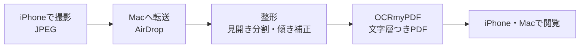

# book_scan

自分の持っている紙の本を、切らずに iPhone で撮影し、Mac で整形と OCR をして、文字検索できる PDF にする。

## 注意
- 自分が所有する本を、私的使用の範囲でだけ使う
- 作った PDF や撮影した写真は配布しない。このリポジトリにも入れない

## 流れ

## 撮影ルール（確定）
- フォーマットは「互換性優先」（JPEG）
- レンズは 1x。フラッシュはオフ
- グリッドと水準器をオンにして、真上から水平に撮る
- 本の上をタップし続けて AE/AF ロックをかける
- 高さ、距離、角度は撮影中に変えない
- シャッターは指で押さず、タイマーか音量ボタンを使う

## 入出力
- 入力: 写真を入れたフォルダ（このリポジトリの外に置く）
- 出力: 文字層つきの PDF

## 設計メモ
- 縦長の画像は表紙として分割しない。横長の画像は真ん中で割る
- 綴じ方向（右開き・左開き）は設定で指定する
- 分割は Python（OpenCV）で自作する。ScanTailor は Mac 版が未確認

## 依存
- OCRmyPDF と tesseract-lang（日本語は `jpn`）。どちらも Homebrew
- Python は専用の `.venv`

## 未決
- 見開き撮影かページごと撮影か（数ページを試して決める）
- 写真と PDF の保存先
- ライセンス（公開するときに決める）
