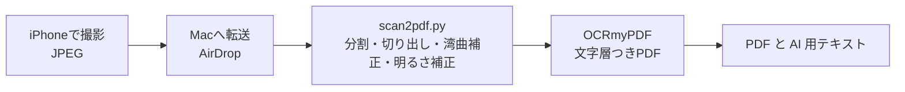

# book_scan

自分の持っている紙の本を、切らずに iPhone で撮影し、Mac で整形と OCR をして、文字検索できる PDF にする。

## 注意
- 自分が所有する本を、私的使用の範囲でだけ使う
- 作った PDF や撮影した写真は配布しない。このリポジトリにも入れない

## 流れ



## 撮影ルール
- フォーマットは「互換性優先」（JPEG）
- レンズは 1x。フラッシュはオフ
- グリッドと水準器をオンにして、真上から水平に撮る
- 本の上をタップし続けて AE/AF ロックをかける
- 高さ、距離、角度は撮影中に変えない
- シャッターは指で押さず、タイマーか音量ボタンを使う
- ジャケット（カバー）は外して撮る。折り返しが写り込むとページが崩れる

## 準備
- `brew install ocrmypdf`
- 日本語データ：tessdata_best の `jpn.traineddata` を tesseract の tessdata フォルダに置く（`tesseract --list-langs` に `jpn` が出れば OK）
- Python の仮想環境（Python 3.11 で動作確認）

```bash
python3 -m venv .venv
.venv/bin/pip install -r requirements.txt
```

## 使い方

```bash
.venv/bin/python scan2pdf.py 写真のフォルダ/*.JPG -o 本の名前.pdf
```

- 写真は撮影順（ファイル名順）に渡す
- 出力：`本の名前.pdf`（文字検索つき）、`本の名前.txt`（AI 用。日本語の文字の間の空白を除いたもの）、`本の名前.noocr.pdf`（OCR 前）

| オプション | 意味 |
|---|---|
| `--rtl` | 右開き（縦書きの本）。右のページを先にする |
| `--cut ファイル名=位置` | 綴じ目の位置（px）を手で指定する。警告が出たときに使う |
| `--max-height` | ページ画像の高さの上限（既定 2600px） |
| `--quality` | JPEG の品質（既定 80） |
| `--no-ocr` | OCR をしない（整形だけ確かめたいとき） |

## 仕組み
- 写真は読み込み時に、長辺 5712px（24MP 相当）へ縮小する。48MP の写真でも動く。判定の値はこの大きさで調整した
- 縦長の写真は表紙とみなす。写真の縁の色（机）との色差から本を切り出し（しきい値は大津の方法で自動で決める）、端に残った机を外側から削る
- 横長の写真は見開きとみなし、綴じ目（周りより暗い細い縦の谷）で左右に割る。谷が浅いときは、左右のページの間の文字のない帯の中央で割る。どちらも見つからなければ警告を出す
- 本文のページは、次の順に整える
  1. 紙の部分を切り出して台形を直す
  2. 端に残った机を削る
  3. 文字の行の上下のずれを区画ごとに測り、なめらかな曲面で当てはめて、湾曲を戻す
  4. 背景の明るさで割って、紙を白くする
  5. 傾きを直して縮小する。湾曲補正をかけたページは回さない。白紙や 2 度を超える推定値でも回さない
- OCR は OCRmyPDF（日本語）で行う

## 試験の実績
- 48MP の写真 118 枚（表紙と裏表紙を含む。234 ページ）で、処理に約 6 分、PDF は約 113MB

## 既知の課題
- 表紙の右端に、机の細い筋が少し残る
- ページを押さえるクリップが写り込む（本文にはかからない）
- 位取りのカンマがピリオドに化ける（20,000 → 20.000）
- PDF の文字層には語の間の空白が残る
- 厚い本、図の多いページ、縦書きの本は未確認

## 未決
- 見開き撮影かページごと撮影か
- ライセンス（公開するときに決める）
